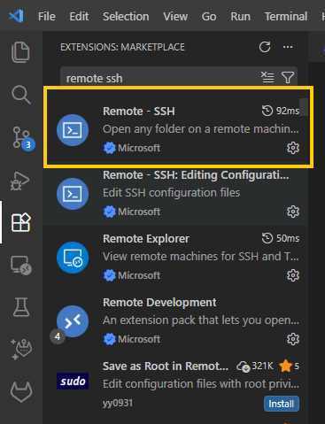
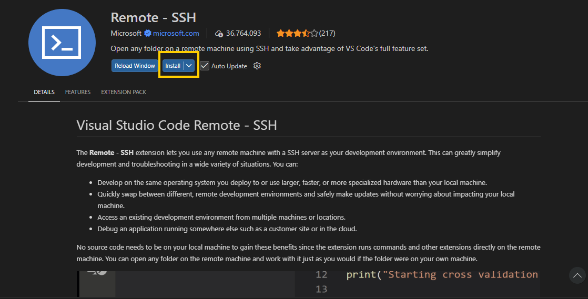

# Python & VS Code Setup

This manual will help you set up your Python development environment on a remote server using Visual Studio Code (VS Code).

Our servers don't allow port forwarding through the standard SSH daemon, so this setup runs a per-user `sshd` on a custom port that VS Code Remote-SSH connects to.

> **Having trouble connecting?** If Remote-SSH can't download or install the VS Code Server on the remote host (for example, the server has no internet access), see [`manual-deploy/`](manual-deploy/README.md) for scripts that copy the server over SSH/SCP for you.

## Contents

- [Prerequisites](#prerequisites)
- [VS Code Setup](#vs-code-setup)
  - [Setting Up SSH Keys](#setting-up-ssh-keys)
  - [Setting Up VS Code Specific SSH Keys on Target Server](#setting-up-vs-code-specific-ssh-keys-on-target-server)
  - [Setting Up VS Code for Remote Development with Python](#setting-up-vs-code-for-remote-development-with-python)
- [Python Setup](#python-setup)
  - [Setting up Nexus Repository for pip](#setting-up-nexus-repository-for-pip)
  - [Creating and Setting Up Python Virtual Environments](#creating-and-setting-up-python-virtual-environments)
  - [Package Management](#package-management)
  - [Running Python Scripts on Command Line using Venv](#running-python-scripts-on-command-line-using-venv)
- [Troubleshooting](#troubleshooting)

# Prerequisites

- Have SSH access to the server you want to develop on
- Have VS Code installed on your local machine (LANHelp)

# VS Code Setup

## Setting Up SSH Keys

Skip this if you can already run `ssh <username>@<server>` without entering a password.

1. On your local machine, open Terminal/PowerShell.
2. Run the following commands on your local machine:
   1. Generate a key. Use the default file path and do not enter a passphrase when prompted, just press Enter.

      ```powershell
      ssh-keygen -t rsa -b 4096 -C <your_work_email>
      ```

   2. Copy the public key to the server:

      ```powershell
      Get-Content "$env:USERPROFILE\.ssh\id_rsa.pub" | ssh user@remote_host "mkdir -p ~/.ssh && cat >> ~/.ssh/authorized_keys"
      ```

3. You should now be able to run `ssh <username>@<server>` without entering a password.

## Setting Up VS Code Specific SSH Keys on Target Server

Reference: internal Confluence page *Remote Debugging Direct SSH Tunnel*.

1. SSH into your target server and run the following commands to set permissions on your home and ssh folders.

   ```bash
   chmod g-w /home/{user}
   chmod 700 /home/{user}/.ssh
   chmod 600 /home/{user}/.ssh/authorized_keys
   ```

2. Create custom RSA and DSA keys for VS Code.

   ```bash
   mkdir ${HOME}/custom_ssh
   ssh-keygen -f ${HOME}/custom_ssh/ssh_host_rsa_key -N '' -t rsa
   ssh-keygen -f ${HOME}/custom_ssh/ssh_host_dsa_key -N '' -t dsa
   ```

3. Create your `sshd_config` file using the following command, but **replace the port number (`2222`) with some random number between 2000 and 49000**. Ensure that this port number does not conflict with anyone else's on your team on this server.

   ```bash
   cat << EOF > ${HOME}/custom_ssh/sshd_config
   Port 2222
   HostKey ${HOME}/custom_ssh/ssh_host_rsa_key
   HostKey ${HOME}/custom_ssh/ssh_host_dsa_key
   AuthorizedKeysFile  .ssh/authorized_keys
   ChallengeResponseAuthentication no
   PubkeyAuthentication yes
   PasswordAuthentication yes
   UsePAM yes
   X11Forwarding yes
   Subsystem sftp /usr/lib/ssh/sftp-server
   PidFile ${HOME}/custom_ssh/sshd.pid
   EOF
   ```

4. Submit a LAN HelpDesk request with the following information:
   1. **Type of Request:** Account > Unix Password Reset/Unlock
      - This directs the request to the relevant team.
   2. **Problem Description** (change the LAN ID and server to your LAN ID and target server):

      ```text
      Please run the following script on <server>:
      $ sudo /usr/sbin/sshd -f <home>/custom_ssh/sshd_config
      $ echo "----- Process ID : ${HOME}/custom_ssh/sshd.pid -------"

      Note: There should not be any errors.
      ```
      - Note: replace <home> with your home directory on the target server. You can get this by executing `cat ${HOME}` on the server.
5. Once that is complete, on your local computer, create and edit this file: `C:\Users\<LAN_ID>\.ssh\config`

   ```text
   Host <hostname>
       HostName <IP/hostname of Server>
       User <LAN_ID>
       Port <your custom port from step 3>
       ForwardAgent yes
       ForwardX11 yes
   ```

## Setting Up VS Code for Remote Development with Python

1. Install the Remote SSH Extension on VS Code.
   - Click on the Extensions icon in the activity bar on the left, then search "Remote – SSH" and click Install.

   

   

2. Do the same for the following packages:
   - Remote Explorer (Microsoft)
   - Remote Development (Microsoft)
   - Python (Microsoft)
   - Python Debugger (Microsoft)
   - Pylance (Microsoft)
3. Press `Ctrl+,` to enter settings, and change these if needed:

   | Setting | Value |
   | --- | --- |
   | Remote.SSH: Config File | `C:\Users\<LAN_ID>\.ssh\config` |
   | Remote.SSH: Local Server Download | Always |
   | Remote.SSH: Use Exec Server | Checked |
   | Remote.SSH: Use Local Server | Checked |

4. You should be able to see the Remote Explorer on the activity bar. Click on it, and you should see all of the hosts in your configuration file.

5. You can press **+** to add a new host. Otherwise, you can hover over a host and choose to open a remote development session with that host in a new window or an existing one. You can now use VS Code to debug and edit your code similarly to how you can do it on your local machine.

# Python Setup

## Setting up Nexus Repository for pip

Reference: internal GitLab wiki page *Using Nexus Repository Manager*. Replace `<nexus-host>` below with the Nexus hostname listed there.

1. On the target server, run the following commands. As you run the commands, it will show you what file the setting is being written to.

   ```bash
   pip config set global.trusted-host <nexus-host>
   pip config set global.index https://<nexus-host>/repository/pypi.org-proxy/pypi
   pip config set global.index-url https://<nexus-host>/repository/pypi.org-proxy/simple
   pip config set global.no-cache-dir false
   ```

2. To test, run `pip install tqdm` (you can substitute whatever package you want, but tqdm is a small, simple library).

## Creating and Setting Up Python Virtual Environments

A Python virtual environment (venv) is a built-in, self-contained directory that isolates project dependencies, prevents package version conflicts, and keeps your system-wide Python installation clean.

1. To create a Python virtual environment, run `python -m venv <path>`. For example, if you want a venv called `.venv` in your current directory, you will run:

   ```bash
   python -m venv .venv
   ```

2. To activate the venv, use one of the following:
   - **On Linux**

     ```bash
     source path/to/venv/bin/activate
     ```

   - **On Windows PowerShell**

     ```powershell
     path\to\venv\Scripts\Activate.ps1
     ```

     > **Note:** If you encounter a "running scripts is disabled on this system" error, you can use the following command to allow running scripts in this shell instance only. On PowerShell, you will need to run this every time you want to activate the venv.
     >
     > ```powershell
     > Set-ExecutionPolicy -Scope Process -ExecutionPolicy Bypass -Force
     > ```

   - **On Windows Command Prompt**

     ```bat
     path\to\venv\Scripts\activate.bat
     ```

3. Anytime you call `python` in this shell, it will now call the specific version of Python, with only the packages installed in this venv being available.
4. You can deactivate the venv at any time by using the `deactivate` command.

## Package Management

1. With the target venv activated, run `pip install <package-name>`. For example, `pip install pandas`.
2. When you have all of your packages installed, you can save them to a `requirements.txt` by running `pip freeze > requirements.txt`.
3. When you want to install all packages from a requirements file, you can run `pip install -r requirements.txt`.

## Running Python Scripts on Command Line using Venv

1. In the terminal, activate your venv using the method needed for your OS.
2. You can now use `python <filename.py>` to run Python code using your venv.

# Troubleshooting

- **VS Code Server fails to download or install on the remote host:** use the manual deployment scripts in [`manual-deploy/`](manual-deploy/README.md). They download the server matching your local VS Code version and copy it to the remote host over SSH/SCP. Pass your custom port with `-p`.
